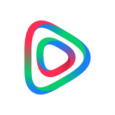

<div align="center">
  <table>
    <tr>
      <td width="180" align="center">
        
      </td>
      <td align="left">
        <h1>Son Player</h1>
      </td>
    </tr>
  </table>
  <p><strong>Offline Android video player powered by Media3 and NextLib</strong></p>
</div>

## App Details

| Category | Details |
|---|---|
| **App name** | Son Player |
| **Developer** | Vilson Sonkar |
| **Package** | `com.sonvideo.player` |
| **Version** | `1.0.0-beta` |
| **Version code** | `1` |
| **Platform** | Android |
| **Minimum Android** | Android 9 / API 28 |
| **Target Android** | API 36 |
| **Architecture** | ARMv7, ARM64 |
| **License** | Apache License 2.0 |

## Downloads and Builds

<p>
  <a href="../../releases/latest"></a>
  <a href="../../actions"></a>
</p>

<p>
  
  
</p>

## Languages

| Language | Size |
|---|---:|
| Java | 35,857,717 bytes |
| Kotlin | 1,116,926 bytes |
| GLSL | 82,462 bytes |
| C++ | 185,877 bytes |
| CMake | 11,871 bytes |
| Shell | 13,823 bytes |
| AIDL | 32,084 bytes |
| Makefile | 5,057 bytes |

## Description

Son Player is an offline, lightweight Android video player built with Jetpack Compose and AndroidX Media3. It provides local video browsing, playback controls, codec/media information, folder sorting, subtitles, audio tracks, and picture-in-picture support.

## Features

### Playback

- Media3 ExoPlayer playback
- Local file and folder access
- Offline-only operation
- Play, pause, rewind, and fast forward
- Playback speed controls
- Lockable player controls
- Continue watching support

### Video and Media

- NextLib FFmpeg and dav1d codec integration
- Codec and media information
- Audio track selection
- Subtitle support
- Resize/aspect-ratio modes
- Picture-in-picture

### Library

- Video folder browser
- Sort videos by name, date added, or file size
- Open a local folder or any supported file
- Empty-library guidance and quick folder setup

### Interface

- Jetpack Compose Material 3 interface
- Portrait and landscape playback
- System UI and player controls
- English localization

## Technical Overview

- **UI:** Jetpack Compose + Material 3
- **Player:** AndroidX Media3 / ExoPlayer
- **Codecs:** NextLib FFmpeg + dav1d
- **Media scanning:** Android storage and file providers
- **Build system:** Gradle Kotlin DSL
- **Minimum SDK:** 28
- **Compile/Target SDK:** 36
- **Java compatibility:** Java 17

## App Resources

- [Android manifest](app/src/main/AndroidManifest.xml)
- [App module build configuration](app/build.gradle.kts)
- [App strings and labels](app/src/main/res/values/strings.xml)
- [Launcher icon](app/src/main/res/mipmap-xxxhdpi/ic_launcher.png)

## Build

```bash
./gradlew :app:assembleDebug
```

The generated debug APK will be available in:

```text
app/build/outputs/apk/debug/
```

Release builds can be created with:

```bash
./gradlew :app:assembleRelease
```

## Releases

- **Release app:** Stable builds are published through [GitHub Releases](../../releases).
- **Beta app:** Development builds are produced by [GitHub Actions](../../actions).
- **App version:** `1.0.0-beta`
- **Update method:** Android APK updates must be installed manually unless an update mechanism is added to the app.

## Developer

**Vilson Sonkar**  
GitHub: [@Vilson1999](https://github.com/Vilson1999)

## License

Licensed under the [Apache License 2.0](LICENSE).
